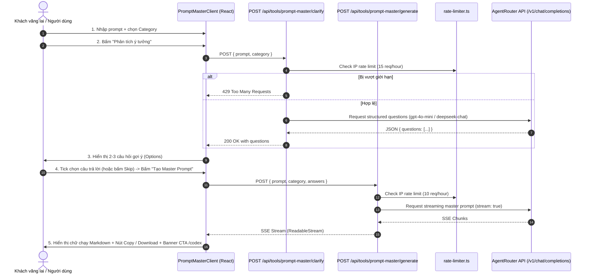

# DaiTruong Store — Master Prompt Generator (Lead Magnet Tool)
## Architectural Specification (Spec)

**Version:** 1.0.0  
**Date:** 2026-10-21  
**Target Environment:** Next.js 14 (App Router), Tailwind CSS, TypeScript  
**Upstream Provider:** Google Gemini API Free Tier (`https://generativelanguage.googleapis.com/v1beta/models/gemini-flash-lite-latest`)  
**Security & Rate Limiting:** In-memory sliding-window via `src/lib/rate-limiter.ts`  

---

## 1. Mục tiêu và Bối cảnh (Objectives & Context)

### 1.1. Mục tiêu sản phẩm
1. **Công cụ Lead Magnet công khai (Free Tool):** Thu hút lập trình viên, content creator, marketer và người dùng AI vãng lai vào website DaiTruong Store.
2. **Nâng cấp câu prompt thô thành Master Prompt chuẩn quốc tế:** Biến 1 câu prompt ngắn (ví dụ: *"viết script cào dữ liệu shopee bằng python"*) thành một Master Prompt hoàn chỉnh có cấu trúc:
   - **Role & Persona** (Đóng vai)
   - **Context & Objective** (Bối cảnh & Mục tiêu)
   - **Step-by-step Instructions** (Chỉ dẫn từng bước)
   - **Constraints & Edge cases** (Giới hạn & Quy tắc cấm)
   - **Output Format** (Định dạng kết quả đầu ra)
3. **Luồng tương tác 2-bước (Refine & Expand Wizard):**
   - Bước 1: Người dùng nhập prompt ngắn và chọn danh mục mục đích.
   - Bước 2: AI tự động phân tích và sinh 2-3 câu hỏi gợi ý/làm rõ dưới dạng nút bấm trắc nghiệm nhanh (người dùng có thể tick chọn hoặc bấm "Bỏ qua & Tạo ngay").
   - Bước 3: Stream kết quả Master Prompt thời gian thực với trải nghiệm gõ chữ mượt mà.
4. **Kêu gọi hành động (Call To Action - CTA):** Gắn liền với hệ sinh thái sản phẩm hiện hữu:
   - Banner CTA điều hướng khách sang `/codex` (*"Thử ngay Master Prompt này trên Cursor & Claude Code với API Key giá rẻ"*).
   - Nút liên kết mua tài khoản AI / ChatGPT / Claude nếu khách chưa có công cụ.

---

## 2. Kiến trúc Hệ thống & Luồng Dữ liệu (System Architecture & Data Flow)

### 2.1. Sơ đồ tuần tự (Sequence Diagram)



---

## 3. Danh mục Phân loại & Cấu trúc Prompt Engine

### 3.1. Các nhóm Category hỗ trợ
1. **`coding` (Lập trình & Dev AI Agents):** Tối ưu cho Cursor, Claude Code, Windsurf, GitHub Copilot. Cấu trúc chuẩn chú trọng Tech stack, Error handling, Code cleanliness, Không viết boilerplate thừa.
2. **`content` (Viết lách & SEO):** Tối ưu bài viết chuẩn SEO, Outline bài báo, phong cách hành văn chuyên gia, tránh văn phong AI chung chung.
3. **`marketing` (Quảng cáo & Bán hàng):** Framework AIDA / PAS, tạo Hooks, Kêu gọi hành động, thông điệp truyền thông.
4. **`image` (Tạo ảnh Midjourney / Flux):** Tối ưu câu lệnh miêu tả chi tiết: Chủ thể, ánh sáng, góc máy, phong cách nghệ thuật, aspect ratio (`--ar`), negative prompts.
5. **`general` (Tự do / Tổng quát):** Phân tích ngữ cảnh tự do theo framework CRISPE (Capacity, Role, Insight, Statement, Personality, Experiment).

---

## 4. Đặc tả API Routes (Next.js App Router)

### 4.1. `POST /api/tools/prompt-master/clarify`
- **Mục đích:** Phân tích câu prompt ngắn và tạo 2-3 câu hỏi làm rõ nhanh kèm các lựa chọn trắc nghiệm.
- **Request Body:**
  ```typescript
  interface ClarifyRequestBody {
    prompt: string;     // Độ dài: 3 - 500 ký tự
    category: "coding" | "content" | "marketing" | "image" | "general";
  }
  ```
- **Xử lý Backend:**
  - Kiểm tra IP rate limit: tối đa 15 requests/giờ/IP.
  - Gọi AgentRouter với System Prompt ép định dạng JSON:
    ```
    Model: gpt-4o-mini (hoặc deepseek-chat)
    Response Format: json_object
    ```
- **Response Format (JSON):**
  ```json
  {
    "success": true,
    "questions": [
      {
        "id": "tech_stack",
        "question": "Bạn muốn áp dụng cho ngôn ngữ/framework nào?",
        "options": ["Next.js / TypeScript", "Python / FastAPI", "Golang", "Khác/Tự do"]
      },
      {
        "id": "detail_level",
        "question": "Mức độ chi tiết của prompt đầu ra?",
        "options": ["Code hoàn chỉnh kèm giải thích", "Chỉ logic cốt lõi & schema", "Tối ưu hiệu năng & bảo mật"]
      }
    ]
  }
  ```

### 4.2. `POST /api/tools/prompt-master/generate`
- **Mục đích:** Tạo nội dung Master Prompt hoàn chỉnh dưới dạng Server-Sent Events (SSE).
- **Request Body:**
  ```typescript
  interface GenerateRequestBody {
    prompt: string;
    category: string;
    answers?: Record<string, string>; // { "tech_stack": "Next.js / TypeScript", ... }
  }
  ```
- **Xử lý Backend:**
  - Kiểm tra IP rate limit: tối đa 10 requests/giờ/IP.
  - Sử dụng System Meta-Prompt chuyên biệt tương ứng với `category`.
  - Gọi AgentRouter với `stream: true`.
  - Stream trực tiếp text chunks về client qua `TransformStream` hoặc `TextEncoderStream`.

---

## 5. Thiết kế Giao diện & Components (Frontend UI/UX)

Tuân thủ quy chuẩn thiết kế Better Design & tông màu sẵn có của DaiTruong Store: Dark Slate (`bg-[#070b14]`, border `slate-800`, text `slate-100`, accents `blue-500`/`indigo-500`).

### 5.1. Cấu trúc Thư mục
```
src/
├── app/
│   └── tools/
│       └── prompt-master/
│           └── page.tsx              # Server Component (SEO metadata, OpenGraph, Breadcrumb)
├── components/
│   └── prompt-master/
│       ├── PromptMasterClient.tsx    # State container & step coordinator
│       ├── PromptInputStep.tsx       # Textarea + Category chips + Nút "Phân tích"
│       ├── ClarifyStep.tsx           # Accordion/Cards 2-3 câu hỏi trắc nghiệm + Nút "Tạo ngay"
│       ├── ResultStep.tsx            # Streaming Markdown viewer + Copy + Download
│       └── CodexCtaBanner.tsx        # CTA card chuyển hướng sang /codex
└── lib/
    ├── prompt-master-constants.ts    # Danh sách category, prompt templates, meta-prompts
    └── gemini-client.ts              # Helper gọi Gemini API an toàn từ server-side
```

### 5.2. Tính năng UI tiện ích cho người dùng
- **1-Click Copy:** Sao chép Master Prompt vào Clipboard với hiệu ứng toast thông báo đã copy.
- **Tải file:** Nút tải về dưới dạng `.txt` hoặc `.md` để lưu trữ làm tài liệu dự án.
- **Nút "Thử nghiệm trên Codex":** Dẫn link trực tiếp tới `https://daitruong.com/codex` hoặc `/codex` với hướng dẫn tích hợp vào Cursor Rules (`.cursorrules`).

---

## 6. Biến Môi Trường (Environment Variables)

Thêm vào `.env`:
```env
# Google Gemini API Config (Free Tier)
GEMINI_API_KEY="AQ.Ab8..."
GEMINI_MODEL="gemini-flash-lite-latest"
```

---

## 7. Kế hoạch Kiểm thử & Đảm bảo Chất lượng (Testing & Verification)

1. **Unit Tests (Vitest):**
   - Kiểm tra logic `gemini-client.ts` xử lý input rỗng, input quá dài.
   - Kiểm tra rate limiter với IP giả lập (chặn request thứ 11 trong 1 giờ).
   - Kiểm tra parsing JSON câu hỏi clarify an toàn (không bị crash nếu LLM trả về format sai).
2. **E2E / Browser Smoke Test (Playwright):**
   - Truy cập `/tools/prompt-master`.
   - Nhập 1 câu prompt, chọn Category "Coding".
   - Kiểm tra hiển thị câu hỏi gợi ý và stream prompt thành công.
   - Kiểm tra nút Copy hoạt động và click banner CTA dẫn tới `/codex`.
